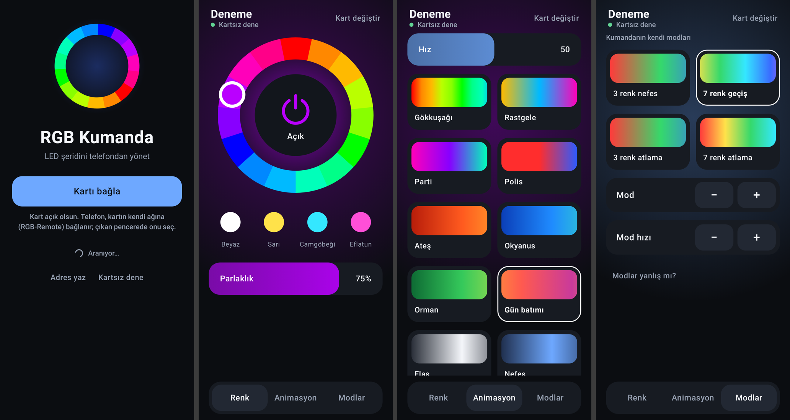

# Analog universal RGB control over ESP

An ESP32 that takes over a cheap analog RGB LED controller (12 V, 4-wire strips) **without replacing its electronics**. It listens to the controller's own 433 MHz remote and sends the same codes straight into the controller chip, so a phone can do everything the remote does and more. The original remote keeps working.

Worked out on a controller marked **FC-L5B-QH44Q-V7.1**.

| Folder | What it is |
|---|---|
| `rgb-remote/` | ESP32 firmware (Arduino): Wi-Fi, HTTP API, animations |
| `android/` | Android app (Kotlin, Jetpack Compose), Turkish and English |
| `tools/rf433-sniffer/` | Reads, decodes and replays remote codes, and maps what the controller does with them |

## Status

| Part | State |
|---|---|
| Reading and sending the remote's codes | Works on the hardware |
| 15 colors, 16 brightness steps, 11 built-in modes | Checked against the controller's outputs |
| Animations | Run on the hardware; police and strobe need low speeds |
| Wi-Fi and the Android app | Built and unit tested, not yet tested end to end |
| Home Assistant | Planned |

## Wiring

```
                         ┌── GPIO 34  (listens)
controller pin 4 (RF) ───┤
                         └── GPIO 27  (sends, floating when idle)
controller pin 8 (GND) ───── ESP32 GND
```

The ESP32 has its own 5 V supply. Do not power it from the controller's 5 V rail: that comes through a 910 Ω resistor and has nothing to spare.

The receiver output swings to about 4.9 V and is weak (a few hundred µA). An **unpowered** ESP32 on that line stops the remote from working.

For measuring only, the three MOSFET gates (R, G, B) can go to GPIO 32, 33 and 25. The board's 4.7 kΩ gate resistors limit the current. Keep the ESP32 powered while they are connected, or the MOSFETs can sit half on.

## The board

| Part | What it is |
|---|---|
| U4 | Unmarked 8-pin microcontroller: 1 VCC, 2–3 EEPROM, 4 RF data, 5/6/7 gates, 8 GND. The pinout matches the Padauk PMS152/PMS154C (not proven) |
| U6 | 24C02 EEPROM |
| IC4 | 433.92 MHz OOK receiver (13.52127 MHz crystal, SYN520R class) |
| Q1, Q3, Q5 | DC010NG MOSFETs, driven by U4 through 4.7 kΩ |

Logic rail 4.88 V, gate 4.83 V, PWM about 400 Hz.

## The remote's code

| Part | Value |
|---|---|
| Sync | high 310 µs, low 5.2 ms |
| Bit 0 | high 310 µs, low 1195 µs |
| Bit 1 | high 1195 µs, low 310 µs |
| Frame | 12-bit remote address, then 8 command bits, each sent twice (28 bits) |
| Held button | one frame about every 62 ms |

It is a fixed code, not a rolling one. **Your remote has its own address**: read it with the sniffer and set `REMOTE_ADDRESS` in `rf_remote.h`.

| Command | Button | Command | Button |
|---|---|---|---|
| `82` | on | `85` | off |
| `86` | brightness + | `83` | brightness − |
| `89` | speed + | `87` | speed − |
| `84` | mode + | `88` | mode − |

Colors are `00pppp11`, where `pppp` is the place on the wheel. Places 2 and 12 do nothing. One more color works that the remote never sends: **`47`**.

| Code | R G B % | Code | R G B % | Code | R G B % |
|---|---|---|---|---|---|
| `3B` | 100 0 0 | `13` | 0 100 0 | `23` | 0 0 100 |
| `3F` | 100 25 0 | `17` | 0 100 25 | `27` | 25 0 100 |
| `03` | 100 50 0 | `47` | 0 100 50 | `2B` | 50 0 100 |
| `07` | 50 100 0 | `1B` | 0 50 100 | `2F` | 100 0 50 |
| `0F` | 25 100 0 | `1F` | 0 25 100 | `37` | 100 0 25 |

### How the controller behaves

- It acts only after **two equal frames**. A single frame is ignored.
- Between colors it fades by itself, 4.4 ms per level, so a full fade takes about 1.1 s. On and off are instant.
- Brightness has 16 steps, 16 % to 100 %. Two frames followed by at least 180 ms of silence is exactly one step. With less silence it counts as a held button.
- The mode buttons walk a loop of 11: 3-color breathe, 7-color fade, blue, red, green, magenta, cyan, yellow, white, 3-color jump, 7-color jump. The controller remembers the place. After a plain color, the first mode press only returns to it.

## Firmware

Arduino IDE with the ESP32 core (2.0.17 was used), board "ESP32 Dev Module". `upload.sh` does the same from a Mac terminal.

With no saved Wi-Fi the board opens its own network **RGB-Remote-XXXX**, password `rgbremote`, with a setup page at `http://192.168.4.1`. The app does the same setup. Wi-Fi details can only be changed over the board's own network.

### HTTP API

There is no password. Use it on a network you trust.

| Request | Does |
|---|---|
| `GET /api/state` | what the light is doing |
| `GET /api/info` | colors, effects, modes |
| `POST /api/set` `on=1` / `on=0` / `on=toggle` | switch |
| `color=0..14` or `rgb=RRGGBB` | color, or the nearest one |
| `bright=0..15` | brightness |
| `effect=rainbow`, `speed=1..100`, `effect=none` | animations |
| `custom=0,5,10` | colors of the custom animation |
| `u4=white` | one of the controller's own modes |
| `calibrate=white` | tells the board which mode shows now |

The controller never answers, so the state is what the board has sent and heard, not a measurement.

## App

```
cd android
./gradlew assembleDebug
```



Open the app and tap **Connect the board**: the phone joins the board's own network and the controls open at once. From there, **Put on home Wi-Fi** moves the board to your Wi-Fi, and the app finds it by itself (mDNS `_rgbremote._tcp`). **Try without a board** shows the screens with nothing connected.
